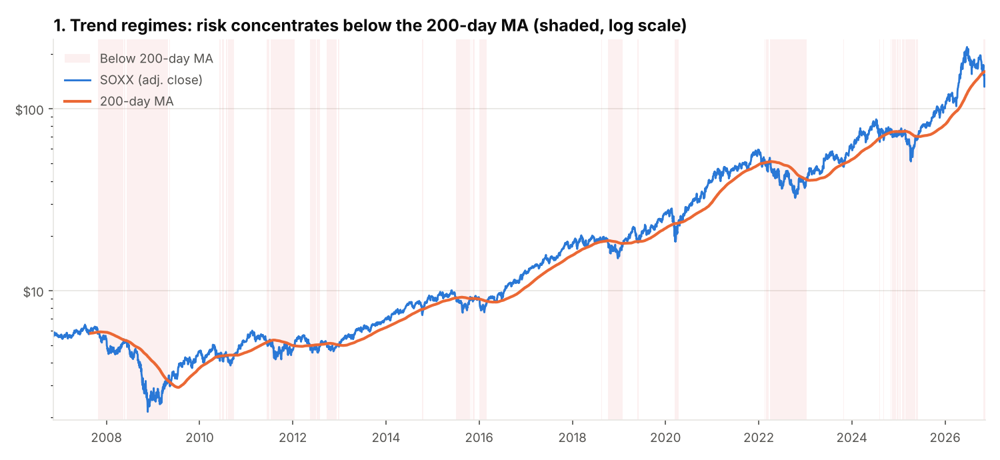
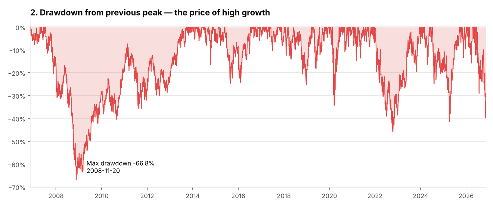
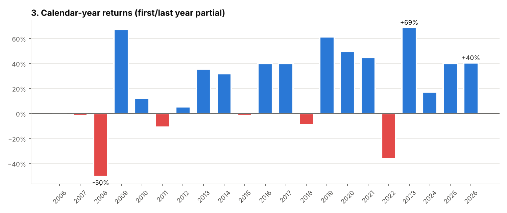
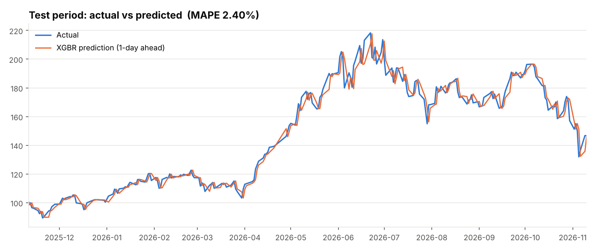
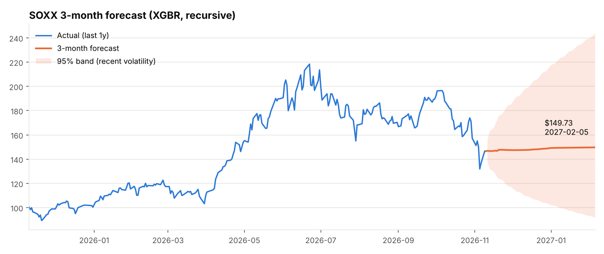

# 필라델피아 반도체 ETF(SOXX) 분석 · 예측 GUI

필라델피아 반도체 ETF(**SOXX**, iShares Semiconductor ETF)의 최근 20년 데이터를 수집·분석하고 XGBoost로 3개월 뒤 가격을 예측하는 데스크톱 GUI 프로그램(tkinter)입니다.

## 실행

```bash
pip install -r requirements.txt
python app.py          # Windows: run_gui.bat 더블클릭
```

> Python 3.10 이상이 필요합니다. Windows와 macOS의 python.org 배포판에는 tkinter가 기본 포함되어 있습니다. Linux에서는 `sudo apt install python3-tk`로 설치하세요.

## 기능 (GUI 버튼)

| 버튼 | 내용 | 저장 파일 (`output/`) |
|---|---|---|
| ① 20년 데이터 다운로드 → 엑셀 저장 | Yahoo Finance에서 일별 OHLCV 데이터 수집(어제까지) | `SOXX_20y_daily.xlsx` (일별 시트와 연도별 요약 시트) |
| ② 분석 · 인사이트 · 시각화 3종 | 핵심 인사이트 텍스트와 차트 3개 | `insights.txt`, `analysis_insights.xlsx`, `1_trend_regime.png`, `2_drawdown.png`, `3_annual_returns.png` |
| ③ XGBR 3개월 예측 | TR/TE로 학습·평가한 뒤 미래 63거래일 예측 | `forecast_3m.xlsx`, `4_test_actual_vs_pred.png`, `5_forecast_3m.png` |
| 전체 실행 | ①→②→③ 순서로 실행 | |

티커 입력란을 바꾸면 다른 종목(예: `SOXL`, `^SOX`)도 같은 방식으로 분석할 수 있습니다.

## 핵심 인사이트 (2026-11-10 기준 실행 결과)

SOXX는 20년간 **연 17.7%(CAGR)** 성장했지만 **MDD는 -67%**인 고수익·고위험 자산입니다. 위험은 **200일 이동평균 아래 국면에 집중**됩니다.

- 변동성: 200일선 아래 42.5%, 위 27.5% (**1.5배**)
- -5% 이상 급락일 비중: 아래 2.83%, 위 0.86% (**3.3배**)
- 3개월 뒤 손실 확률: 아래 37%, 위 29%
- 샤프 비율은 200일선 위 국면이 우세합니다(0.76 대 0.58). 평균 수익률은 두 국면이 비슷합니다. 반등이 아래 국면에서 일어나기 때문입니다.

시각화 3종:
1. 추세 국면: 로그 가격, 200일선, 200일선 아래 구간 음영
2. 고점 대비 낙폭(Underwater)
3. 연도별 수익률

## 예측 모델

- **모델**: `XGBRegressor`
- **TR**: 20년 전부터 1년 전까지 / **TE**: 1년 전부터 어제까지 (경계를 넘는 타깃은 학습에서 제외해 누출을 막음)
- **타깃**: 다음 거래일 로그수익률. 예측가격은 전일 종가 × exp(예측 수익률)입니다. 트리 모델은 학습 범위 밖의 가격 수준을 외삽하지 못하므로 가격 대신 수익률을 학습합니다.
- **피처**: 1~10일 시차 수익률, 5/10/20/60/120/200일 이평 괴리율, 변동성, 모멘텀, RSI14, 52주 고점 대비 낙폭 (모두 t 시점까지의 데이터만 사용)
- **미래 3개월**: 전체 데이터로 다시 학습한 뒤 63거래일을 재귀 예측합니다. 최근 1년 변동성으로 95% 범위를 함께 표시합니다.

### 성능 (실제 SOXX 데이터)

| 지표 | 값 |
|---|---|
| **TE MAPE (1일 선행 가격 예측)** | **2.40%, 목표 5% 미만 달성** |
| 참고: 전일 종가 그대로 쓰는 단순 모델 MAPE | 2.37% |
| 참고: 방향 적중률 | 52.0% |
| 참고: TE 시작 시점부터 63일 재귀 예측 MAPE | 6.05% |

⚠️ 일간 수익률은 거의 예측할 수 없습니다. 모델은 MAPE 기준(5% 미만)을 충족하지만, 전일 종가를 그대로 쓰는 단순 모델보다 낫지는 않습니다. 3개월 재귀 예측은 추세를 참고하는 용도로만 쓰고 투자 판단의 근거로 사용하지 마세요.

## 테스트

```bash
pytest              # 가상 데이터로 오프라인 테스트 (10개)
pytest --live -s    # 실제 SOXX 데이터로 MAPE 5% 미만 검증 포함
```

## 구조

```
app.py              # tkinter GUI (작업은 백그라운드 스레드에서 실행)
soxx_app/data.py    # ① 다운로드, 엑셀 저장/불러오기
soxx_app/analysis.py# ② 인사이트, 시각화 3종
soxx_app/model.py   # ③ XGBR 학습/평가/3개월 예측
tests/              # pytest
```

## 결과 예시






